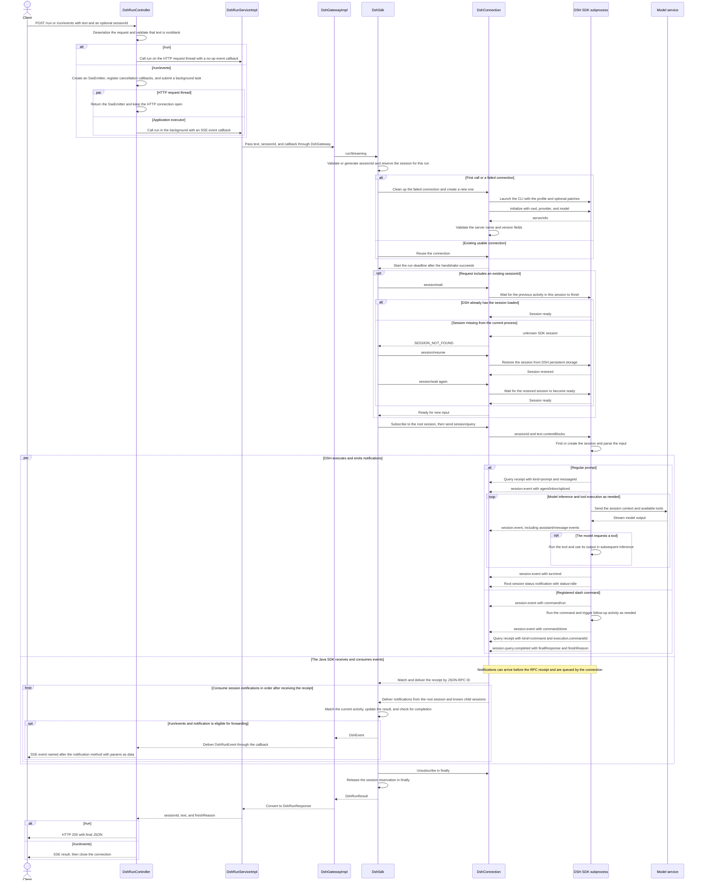

# java-dsh-bridge

[简体中文](README.md) · **English**

A community Java SDK and HTTP service for [DeepSeek Harness](https://github.com/deepseek-ai/deepseek-harness). Java applications can call the SDK directly. Other clients can get a final JSON response over HTTP, stream run events with Server-Sent Events (SSE), or continue a conversation using the same session ID. The project uses JDK 21, Spring Boot 4.1.3, and Tomcat 11.0.29.

## Quick start

Follow the steps below to build from source. For binary ZIPs and local SDK installation, see the [v0.1.0 release notes](RELEASE.en.md). CI runs on Linux and macOS. Maven Wrapper also provides a Windows build entry point.

Use JDK 21 to build and run the Bridge. The Maven Wrapper downloads a pinned version of Maven. The tested DSH version is [0.2.2-rc.2](https://github.com/deepseek-ai/deepseek-harness/releases/tag/dsh-v0.2.2-rc.2). With Node.js 24.9 or later, run `npm install --global @deepseek-ai/dsh@0.2.2-rc.2`. You can also run `python -m pip install deepseek-harness-sdk==0.2.2rc2` in a virtual environment using Python 3.10 or later, then activate that environment to use its `dsh` command.

Set `DEEPSEEK_API_KEY` in the environment that will run the Bridge, then run the following commands from the project root. To build in Windows PowerShell, use `.\mvnw.cmd clean verify`. For credential setup, see the [DSH SDK guide](https://github.com/deepseek-ai/deepseek-harness/blob/dsh-v0.2.2-rc.2/docs/user/guide/python-sdk.md).

```sh
./mvnw clean verify
mkdir -p .dsh/home .dsh/workspace
DSH_HOME="$PWD/.dsh/home" dsh --version
java -jar start/target/java-dsh-bridge-0.1.0.jar \
  --dsh.bridge.dsh-home=.dsh/home \
  --dsh.bridge.working-directory=.dsh/workspace
```

The service listens on `127.0.0.1:8080` by default. It starts DSH and performs the handshake on the first valid request. Any client that can reach the service can submit a run. SSE events may expose tool inputs, tool outputs, and workspace data. For remote access and service account permissions, see the [security policy](SECURITY.en.md).

## HTTP API

```sh
curl -sS http://127.0.0.1:8080/run \
  -H 'Content-Type: application/json' \
  -d '{"text":"Describe DeepSeek Harness in one sentence."}'
```

`POST /run` waits for the run to finish and returns a JSON response like this one.

```json
{"sessionId":"session-…","text":"Final reply","finishReason":"completed"}
```

```sh
curl -N http://127.0.0.1:8080/run/events \
  -H 'Content-Type: application/json' \
  -H 'Accept: text/event-stream' \
  -d '{"text":"Describe DeepSeek Harness in one sentence."}'
```

`POST /run/events` streams DSH notifications over the same connection. The SSE event name is the original notification method, such as `session.event`, and the event data contains its JSON parameters. The stream sends `result` on success or `error` on an SDK failure, then closes. For the synchronous endpoint, startup or upstream execution failures return HTTP 502. Startup or execution timeouts return HTTP 504. The `finishReason` field reports the outcome and may be `null` if DSH supplies no reason. Once the stream opens, read `result` or `error` to determine the outcome. An SSE response with HTTP 200 can still contain an `error` event. Clients can ignore `:heartbeat` comment lines.

### Continue a conversation

Omit `sessionId` on the first turn. Take the ID from the JSON response to `/run` or the `result` event from `/run/events`, then include it in the request body of either endpoint on the next turn.

```sh
curl -sS http://127.0.0.1:8080/run \
  -H 'Content-Type: application/json' \
  -d '{"text":"Remember that my project is called java-dsh-bridge."}'

# Replace sessionId with the value returned by the first request.
curl -N http://127.0.0.1:8080/run/events \
  -H 'Content-Type: application/json' \
  -H 'Accept: text/event-stream' \
  -d '{"sessionId":"session-1234567890abcdef1234567890abcdef","text":"What is my project called?"}'
```

Each session processes one turn at a time. After the DSH process restarts, the Bridge attempts to restore the session from the configured DSH data directory.

| Error code | `/run` HTTP status | Meaning |
| --- | --- | --- |
| `INVALID_SESSION_ID` | 400 | The ID format is invalid |
| `SESSION_NOT_FOUND` | 404 | The session does not exist in DSH |
| `SESSION_BUSY` | 409 | The same session is processing another turn |

`/run/events` returns the same codes in `error` events.

## DSH configuration

You can override the following properties in Spring Boot configuration.

| Property | Default and purpose |
| --- | --- |
| `dsh.app.path` | Unset by default. Path to the root of a built DSH checkout. The Bridge trims surrounding whitespace and resolves relative paths from the application startup directory |
| `dsh.bridge.command` | Optional executable and arguments, for example `[node, /path/to/cli/lib/bin.js]` |
| `DSH_EXECUTABLE` | Optional environment variable for the absolute path to the DSH executable |
| `dsh.bridge.working-directory` | `.`. Initial working directory for the DSH process and new sessions. Relative paths are resolved from the Java application's startup directory |
| `dsh.bridge.dsh-home` | DSH data directory for configuration, credentials, and caches. If unset, the DSH CLI applies its own rules. A CLI installed through Python requires either this property or `DSH_HOME` |
| `dsh.bridge.profile` | `sdk` |
| `dsh.bridge.patch-files` | Optional list of patch files to load at startup |
| `dsh.bridge.provider` / `dsh.bridge.model` | `deepseek-official` / `deepseek-v4-flash` |
| `dsh.bridge.initialize-timeout` | `30s`. Deadline for the initial handshake |
| `dsh.bridge.run-timeout` | `5m`. After initialization, session recovery, run RPCs, and event waits share this deadline. Set `0s` for an unlimited wait |
| `dsh.bridge.sse-heartbeat-interval` | `15s`. Interval between SSE heartbeat comments. Set `0s` to disable them |

DSH uses the model configuration and credentials from its startup environment. Java stops waiting and releases the subscription on a timeout or when a heartbeat, event write, or servlet callback detects that the SSE client disconnected. Work already submitted to DSH may continue. A request continuing the session still waits for the previous activity. When proxying SSE, disable response buffering and set the read-idle timeout longer than the heartbeat interval.

The Bridge checks `dsh.app.path`, `dsh.bridge.command`, and `DSH_EXECUTABLE` in that order and uses the first non-empty setting. If all three are empty, it looks for `dsh` on `PATH`. With `dsh.app.path` set, it uses `node` to launch `apps/cli/lib/bin.js` under that directory. For a built checkout, pass `--dsh.app.path=/path/to/deepseek-harness`. The Bridge logs an error if it cannot access the specified directory or CLI file.

If the DSH subprocess fails to start or initialize, the application logs and HTTP or SSE response identify the stage that failed. Process launch, connection, and handshake failures return `STARTUP_ERROR`. A handshake timeout returns `STARTUP_TIMEOUT`. The synchronous endpoint maps these to HTTP 502 and 504, respectively.

## Standalone SDK

Install the parent POM and SDK module into your local Maven repository.

```sh
./mvnw -pl java-dsh-bridge-sdk -am install
```

Other Maven projects can then declare the following dependency. The SDK uses Java and Jackson and runs independently of the application's Spring container.

```xml
<dependency>
    <groupId>cn.zntime.dsh.bridge</groupId>
    <artifactId>java-dsh-bridge-sdk</artifactId>
    <version>0.1.0</version>
</dependency>
```

Add `dsh` to `PATH` to use the default configuration. If you installed DSH through Python, also set `DSH_HOME` before launching your Java application. `DshSdkConfig.defaults()` waits indefinitely for a run. Set `runTimeout` to bound the wait. Interactive approval and user-question handling remain with the native runtime policy. This release exposes Java callbacks for run events.

```java
import cn.zntime.dsh.bridge.sdk.DshSdk;
import cn.zntime.dsh.bridge.sdk.DshSdkConfig;

try (var sdk = new DshSdk(DshSdkConfig.defaults())) {
    var result = sdk.runStreaming("Hello", event -> System.out.println(event.method()));
    System.out.println(result.text());
}
```

## Project modules

```text
java-dsh-bridge
├── java-dsh-bridge-client          # Application service interfaces, run commands, and DTOs
├── java-dsh-bridge-adapter         # HTTP and SSE
├── java-dsh-bridge-app             # Application services
├── java-dsh-bridge-domain          # DSH gateway port
├── java-dsh-bridge-infrastructure  # Gateway implementation and DSH configuration
├── java-dsh-bridge-sdk             # Standalone SDK, process lifecycle, and JSON-RPC
└── start                           # Spring Boot entry point and executable JAR
```

## Request flow

Spring Boot creates a shared `DshSdk` at startup. The first valid request starts the DSH subprocess. HTTP clients connect to Spring Boot. Java and DSH exchange one JSON-RPC 2.0 message per line over stdin and stdout, with stderr read separately. DSH sends the requests to the model service.

See the [implementation notes](docs/architecture-implementation.md) and [message dispatch notes](docs/dsh-connection-message-dispatch.md) in Chinese.



- **Regular prompts.** The SDK starts collecting events after matching the receipt's `messageId` to `agent/inbox/spliced` in the root session. It reads the text from the latest `assistant/message` and the finish reason from `turn/end`, then returns when the root session reports `session.status=idle`. The `session/wait` call checks that the previous turn has finished before continuing the conversation.
- **Slash commands.** The SDK matches the receipt's `execution.commandId` to `command/run`, then waits for both `command/done` and `session.query.completed`. The two completion notifications can arrive in either order. The SDK consumes `session.query.completed` and delivers its result in the SSE `result` event or the HTTP JSON response.
- **Concurrency and interruption.** The JVM allows one active turn per session ID. Different sessions can share the same process. The connection serializes stdin writes, routes replies by RPC ID, and queues notifications by session tree. An execution timeout or a detected SSE disconnect ends the JVM's wait, unsubscribes from events, and releases the session. Activity already submitted to DSH may continue. A later request reconnects after a connection failure.

### Error responses

| Failure | `/run` | `/run/events` |
| --- | --- | --- |
| Malformed request JSON or blank `text` | HTTP 400 | HTTP 400 before the SSE stream opens |
| The SSE executor rejects the task | — | HTTP 503 before the SSE stream opens |
| Invalid session ID, missing session, or busy session | HTTP 400, 404, or 409 | `error` event with `INVALID_SESSION_ID`, `SESSION_NOT_FOUND`, or `SESSION_BUSY`, respectively |
| Startup failure or upstream execution error | HTTP 502 | `error` event with `STARTUP_ERROR` or `UPSTREAM_ERROR` |
| Handshake or execution timeout | HTTP 504 | `error` event with `STARTUP_TIMEOUT` or `TIMEOUT` |

`/run` maps DSH exceptions to a `ProblemDetail` with a `code` field. If a run fails on the SSE endpoint, the Bridge sends an `error` event containing `code` and `message`, then closes the connection. Runs that reach completion report `finishReason` with their result.

Source entry points include the [HTTP and SSE controller](java-dsh-bridge-adapter/src/main/java/cn/zntime/dsh/bridge/adapter/web/DshRunController.java), [application service](java-dsh-bridge-app/src/main/java/cn/zntime/dsh/bridge/app/run/service/DshRunServiceImpl.java), [gateway](java-dsh-bridge-infrastructure/src/main/java/cn/zntime/dsh/bridge/infrastructure/gateway/DshGatewayImpl.java), [session execution](java-dsh-bridge-sdk/src/main/java/cn/zntime/dsh/bridge/sdk/DshSdk.java), and [stdio connection](java-dsh-bridge-sdk/src/main/java/cn/zntime/dsh/bridge/sdk/DshConnection.java).

## Known limitations

### Accumulated DSH sessions can exhaust memory

The Java Bridge releases each run's event subscription when the request ends. The current DSH SDK holds session objects and their event histories until the runtime shuts down. In a long-running service, repeatedly creating new session IDs can fill the memory available to a single DSH process. Memory usage depends on the number of sessions, the size of their histories, and the deployment's memory limit.

- **Interrupted requests.** If DSH runs out of memory and exits while the Java Bridge is still running, every pending request that shares the process is affected. `/run` returns HTTP 502 with `UPSTREAM_ERROR`. `/run/events` may already have sent partial output before sending an `error` event and closing the connection.
- **Uncertain outcomes for external actions.** DSH may exit after a tool performs a write and before it returns the result. Retrying with the same `sessionId` submits a new message and can repeat the write.
- **Recovery on a later request.** The next request starts a new DSH process. A request with an existing `sessionId` can restore the history that DSH had persisted to disk.

Future work will address reclaiming memory per session and verify that a conversation can resume from persisted history under the same `sessionId` after its in-memory state is released.

## Contributing and license

This project is licensed under [Apache License 2.0](LICENSE). See [NOTICE](NOTICE) for third-party license and attribution information. For reporting issues and submitting changes, see the [contribution guide](CONTRIBUTING.en.md).
