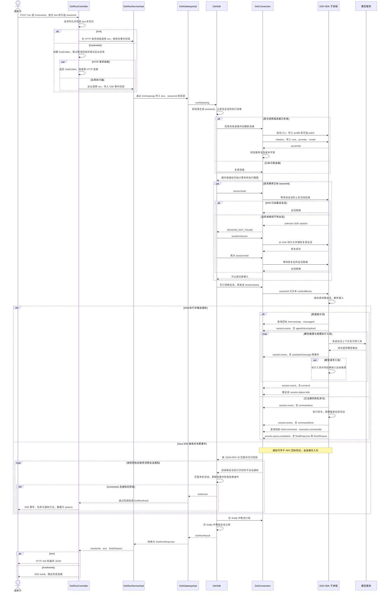

# Java DSH Bridge — DeepSeek Harness Java SDK

**简体中文** · [English](README.en.md)

Java DSH Bridge 是 [DeepSeek Harness (DSH)](https://github.com/deepseek-ai/deepseek-harness) 的社区 Java SDK 和 HTTP/SSE 桥接服务。Java 应用可以直接通过 SDK 调用 DSH，其他应用可以通过 HTTP 获取最终 JSON、通过 SSE 接收运行事件，并使用同一个会话 ID 继续对话。

[快速开始](#快速开始) · [HTTP 接口](#http-接口) · [Java SDK](#独立-sdk)

SDK 的 Maven 坐标为 `cn.zntime.dsh.bridge:java-dsh-bridge-sdk:0.1.0`。使用 JDK 21，已验证 DeepSeek Harness [0.2.2-rc.2](https://github.com/deepseek-ai/deepseek-harness/releases/tag/dsh-v0.2.2-rc.2)。参阅 [SDK 本地安装步骤](RELEASE.md#本地安装-sdk)。

## 快速开始

[下载 v0.1.0 的 Bridge 和 SDK ZIP](https://github.com/newind85/java-dsh-bridge/releases/tag/v0.1.0)，或按下方步骤从源码构建。HTTP 服务使用 Spring Boot 4.1.3 和 Tomcat 11.0.29。CI 在 Linux 和 macOS 上运行，Windows 提供 Maven Wrapper 构建入口。

Maven Wrapper 会下载固定版本的 Maven。使用 Node.js 24.9 或更高版本时，可执行 `npm install --global @deepseek-ai/dsh@0.2.2-rc.2`。也可以在 Python 3.10 或更高版本的虚拟环境中执行 `python -m pip install deepseek-harness-sdk==0.2.2rc2`，随后激活该环境以使用其中的 `dsh`。

在运行 Bridge 的环境中配置 `DEEPSEEK_API_KEY`，然后在项目根目录执行以下命令。Windows PowerShell 下构建时使用 `.\mvnw.cmd clean verify`。凭据配置见 [DSH SDK 指南](https://github.com/deepseek-ai/deepseek-harness/blob/dsh-v0.2.2-rc.2/docs/user/guide/python-sdk.zh.md)。

```sh
./mvnw clean verify
mkdir -p .dsh/home .dsh/workspace
DSH_HOME="$PWD/.dsh/home" dsh --version
java -jar start/target/java-dsh-bridge-0.1.0.jar \
  --dsh.bridge.dsh-home=.dsh/home \
  --dsh.bridge.working-directory=.dsh/workspace
```

服务默认监听 `127.0.0.1:8080`，在首个有效请求到达时启动 DSH 并握手。任何可以访问接口的调用方都可以提交运行请求，SSE 可能返回工具输入、输出及工作区数据。远程访问和运行账户权限见 [安全策略](SECURITY.md)。

## HTTP 接口

```sh
curl -sS http://127.0.0.1:8080/run \
  -H 'Content-Type: application/json' \
  -d '{"text":"用一句话介绍 DeepSeek Harness"}'
```

`POST /run` 等待执行结束，返回如下 JSON。

```json
{"sessionId":"session-…","text":"最终回复","finishReason":"completed"}
```

```sh
curl -N http://127.0.0.1:8080/run/events \
  -H 'Content-Type: application/json' \
  -H 'Accept: text/event-stream' \
  -d '{"text":"用一句话介绍 DeepSeek Harness"}'
```

`POST /run/events` 在同一连接上推送 DSH 通知，SSE 名称使用原生通知方法，例如 `session.event`，数据是该通知的 JSON 参数。成功结束时推送 `result`，SDK 调用失败时推送 `error`，之后关闭连接。同步接口的启动失败或上游执行错误返回 HTTP 502，启动或执行超时返回 HTTP 504。模型的业务结算状态随 `finishReason` 返回，DSH 没有提供结束原因时该值可能为 `null`。流打开后，请读取 `result` 或 `error` 判断本次运行结果。HTTP 状态为 200 的 SSE 响应仍可能包含 `error`。`:heartbeat` 是 SSE 注释，客户端可以忽略。

### 使用同一会话继续对话

第一轮省略 `sessionId`。从 `/run` 的 JSON 响应或 `/run/events` 的 `result` 事件取得 ID，下一轮在任一接口的请求体中带上它。

```sh
curl -sS http://127.0.0.1:8080/run \
  -H 'Content-Type: application/json' \
  -d '{"text":"记住，我的项目叫 java-dsh-bridge"}'

# 将 sessionId 换成第一轮响应中的实际值
curl -N http://127.0.0.1:8080/run/events \
  -H 'Content-Type: application/json' \
  -H 'Accept: text/event-stream' \
  -d '{"sessionId":"session-1234567890abcdef1234567890abcdef","text":"我的项目叫什么？"}'
```

每个会话同时处理一轮。DSH 进程重启后，应用会尝试从配置的 DSH 数据目录恢复该 ID。

| 错误码 | `/run` HTTP 状态 | 含义 |
| --- | --- | --- |
| `INVALID_SESSION_ID` | 400 | ID 格式无效 |
| `SESSION_NOT_FOUND` | 404 | 会话在 DSH 中不存在 |
| `SESSION_BUSY` | 409 | 同一会话正在处理另一轮 |

`/run/events` 通过 `error` 事件返回相同错误码。

## DSH 配置

下列属性可通过 Spring Boot 配置覆盖。

| 属性 | 默认值与用途 |
| --- | --- |
| `dsh.app.path` | 默认留空。可指定已构建的 DSH 工程根目录。忽略首尾空白，相对路径以应用启动目录为基准 |
| `dsh.bridge.command` | 可选的可执行文件和参数，例如 `[node, /path/to/cli/lib/bin.js]` |
| `DSH_EXECUTABLE` | 可选环境变量，可设置为 DSH 可执行文件的绝对路径 |
| `dsh.bridge.working-directory` | `.`。DSH 进程和新会话的初始工作目录，相对路径以 Java 应用的启动目录为基准 |
| `dsh.bridge.dsh-home` | DSH 用户数据目录，用于存放配置、凭据和缓存。留空时沿用 DSH CLI 自身的规则。通过 Python 安装的 CLI 要求显式配置该属性或 `DSH_HOME` |
| `dsh.bridge.profile` | `sdk` |
| `dsh.bridge.patch-files` | 可选的启动 patch 文件列表 |
| `dsh.bridge.provider` / `dsh.bridge.model` | `deepseek-official` / `deepseek-v4-flash` |
| `dsh.bridge.initialize-timeout` | `30s`。首次握手的期限 |
| `dsh.bridge.run-timeout` | `5m`。从握手完成开始，续接 RPC、执行 RPC 和事件等待共用此期限。`0s` 表示不限时 |
| `dsh.bridge.sse-heartbeat-interval` | `15s`。SSE 注释心跳的间隔，`0s` 表示关闭心跳 |

模型配置和凭据沿用 DSH 的启动环境。等待超时或 Bridge 通过心跳、事件写入或 Servlet 回调检测到 SSE 断开时，Java 侧会停止等待并释放本轮订阅。已经提交的 DSH 活动可能继续，续接请求仍会等待上轮活动结束。通过反向代理提供 SSE 时，应关闭响应缓冲，并让代理的读空闲超时长于心跳间隔。

启动命令依次检查 `dsh.app.path`、`dsh.bridge.command` 和 `DSH_EXECUTABLE`，采用第一个非空配置。三项都留空时，使用 `PATH` 上的 `dsh`。填写 `dsh.app.path` 时，应用通过 `node` 启动该目录下的 `apps/cli/lib/bin.js`。例如，从已构建的源码启动时使用 `--dsh.app.path=/path/to/deepseek-harness`。如果显式指定的目录或 CLI 文件无法访问，应用会记录错误。

DSH 子进程启动或初始化失败时，应用日志及本次 HTTP 或 SSE 响应会指出失败阶段。进程启动、连接或握手失败返回 `STARTUP_ERROR`，初始化超时返回 `STARTUP_TIMEOUT`。同步接口的 HTTP 状态分别为 502 和 504。

## 独立 SDK

在本地安装父 POM 和 SDK 模块。

```sh
./mvnw -pl java-dsh-bridge-sdk -am install
```

安装后，其他 Maven 工程可以从本机 Maven 仓库引用以下依赖。SDK 使用纯 Java 和 Jackson，与应用的 Spring 容器解耦。

```xml
<dependency>
    <groupId>cn.zntime.dsh.bridge</groupId>
    <artifactId>java-dsh-bridge-sdk</artifactId>
    <version>0.1.0</version>
</dependency>
```

将 `dsh` 加入 `PATH` 后即可使用默认配置。通过 Python 安装的 DSH 还需要在启动 Java 程序前设置 `DSH_HOME`。`DshSdkConfig.defaults()` 的执行等待不限时，可通过 `runTimeout` 设置期限。当前 SDK 提供运行事件回调。交互式审批与用户提问沿用 DSH 运行时的原生处理策略。

```java
import cn.zntime.dsh.bridge.sdk.DshSdk;
import cn.zntime.dsh.bridge.sdk.DshSdkConfig;

try (var sdk = new DshSdk(DshSdkConfig.defaults())) {
    var result = sdk.runStreaming("你好", event -> System.out.println(event.method()));
    System.out.println(result.text());
}
```

## 模块结构

```text
java-dsh-bridge
├── java-dsh-bridge-client          # 应用服务接口、运行命令和 DTO
├── java-dsh-bridge-adapter         # HTTP 与 SSE
├── java-dsh-bridge-app             # 应用服务
├── java-dsh-bridge-domain          # DSH Gateway 端口
├── java-dsh-bridge-infrastructure  # Gateway 实现与 DSH 配置
├── java-dsh-bridge-sdk             # 独立 Java SDK、进程与 JSON-RPC 通信
└── start                           # Spring Boot 入口和可执行 JAR
```

## 系统请求时序

Spring Boot 启动时装配共享的 `DshSdk`，首个有效请求才启动 DSH 子进程。HTTP 调用方只连接 Spring Boot。Java 与 DSH 通过 stdin/stdout 交换 JSON-RPC 2.0 消息，每行一帧，stderr 独立读取。模型请求由 DSH 发起。

首次同步请求的连接建立、等待唤醒和结果返回见[架构实现方案](docs/architecture-implementation.md)和[连接消息分发](docs/dsh-connection-message-dispatch.md)。



- **普通提示词**用回执的 `messageId` 匹配根会话的 `agent/inbox/spliced` 后开始收集。从最近一次 `assistant/message` 提取文本，从 `turn/end` 读取结束原因，收到根会话的 `session.status=idle` 后返回。图中的 `session/wait` 用于续接前确认上一轮已结束。
- **斜杠命令**用回执的 `execution.commandId` 匹配 `command/run`，同时等到对应的 `command/done` 和 `session.query.completed` 后返回。两种结束通知可按任一顺序到达，`session.query.completed` 由 SDK 消费，其结果通过 SSE `result` 或 HTTP JSON 交付。
- **并发与中断**。JVM 按 ID 限制每个会话同时运行一轮，不同会话可共享同一个进程。连接串行写入 stdin，按 RPC ID 匹配应答，按会话树缓冲通知。执行超时或检测到 SSE 断开时，JVM 会退出等待并释放订阅和会话占用，已提交的 DSH 活动可能继续。连接失效后，后续请求会重建连接。

### 请求失败时的返回

| 失败阶段 | `/run` | `/run/events` |
| --- | --- | --- |
| 请求 JSON 无法解析或 `text` 为空白 | HTTP 400 | HTTP 400，尚未建立 SSE 流 |
| SSE 执行器拒绝任务 | — | HTTP 503，尚未建立 SSE 流 |
| 会话 ID 无效、会话不存在、会话正忙 | HTTP 400、404、409 | `error` 事件，错误码分别为 `INVALID_SESSION_ID`、`SESSION_NOT_FOUND`、`SESSION_BUSY` |
| 启动失败或上游执行异常 | HTTP 502 | `error` 事件，错误码为 `STARTUP_ERROR` 或 `UPSTREAM_ERROR` |
| 握手或执行超时 | HTTP 504 | `error` 事件，错误码为 `STARTUP_TIMEOUT` 或 `TIMEOUT` |

`/run` 将 DSH 异常映射为带 `code` 的 `ProblemDetail`。SSE 运行失败时发送带 `code` 和 `message` 的 `error` 事件，随后完成连接。正常结算得到的 `finishReason` 随结果返回。

源码入口见 [HTTP 与 SSE](java-dsh-bridge-adapter/src/main/java/cn/zntime/dsh/bridge/adapter/web/DshRunController.java)、[应用服务](java-dsh-bridge-app/src/main/java/cn/zntime/dsh/bridge/app/run/service/DshRunServiceImpl.java)、[网关](java-dsh-bridge-infrastructure/src/main/java/cn/zntime/dsh/bridge/infrastructure/gateway/DshGatewayImpl.java)、[会话执行](java-dsh-bridge-sdk/src/main/java/cn/zntime/dsh/bridge/sdk/DshSdk.java)和 [stdio 连接](java-dsh-bridge-sdk/src/main/java/cn/zntime/dsh/bridge/sdk/DshConnection.java)。

## 已知限制

### DSH 会话累积可能耗尽内存

Java Bridge 在请求结束后释放本轮的事件订阅。当前 DSH SDK 会继续持有会话对象及其事件历史，直到运行时关闭。长时间运行时，持续创建新 `sessionId` 会使单个 DSH 进程中的会话不断累积，可能耗尽内存。实际占用取决于累计会话数、历史大小和部署的内存上限。

- **请求中断。** 如果 DSH 因内存耗尽退出且 Java Bridge 仍在运行，共用该进程、尚未取得最终结果的请求都会受影响。`/run` 返回 HTTP 502，错误码为 `UPSTREAM_ERROR`。`/run/events` 可能已经发送部分输出，随后发送 `error` 事件并结束连接。
- **外部操作结果不确定。** DSH 可能在工具完成写入后、返回结果前退出。用同一个 `sessionId` 重发会提交新消息，可能导致重复写入。
- **后续请求恢复。** 后续请求会启动新的 DSH 进程。传入已有的 `sessionId` 可以恢复已写入磁盘的历史。

后续迭代将处理单会话的内存回收，并验证释放后能用同一个 `sessionId` 从持久化历史恢复对话。

## 贡献与许可

本项目采用 [Apache License 2.0](LICENSE)，详见[中文导读](LICENSE.zh-CN.md)。上游项目与构建工具的许可和署名见[中文声明](NOTICE.zh-CN.md)和 [NOTICE](NOTICE)。提交问题和变更前可查看[贡献指南](CONTRIBUTING.md)。
