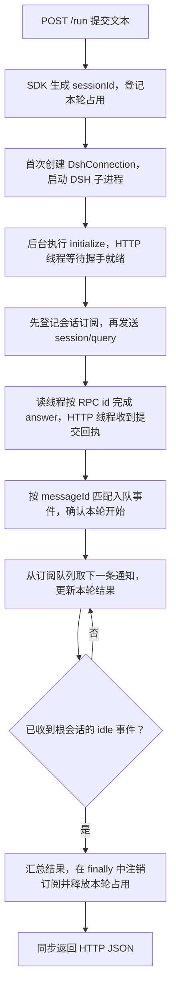
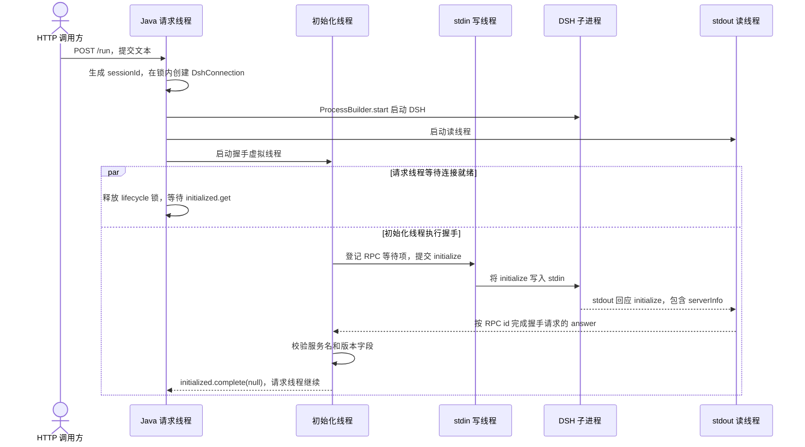
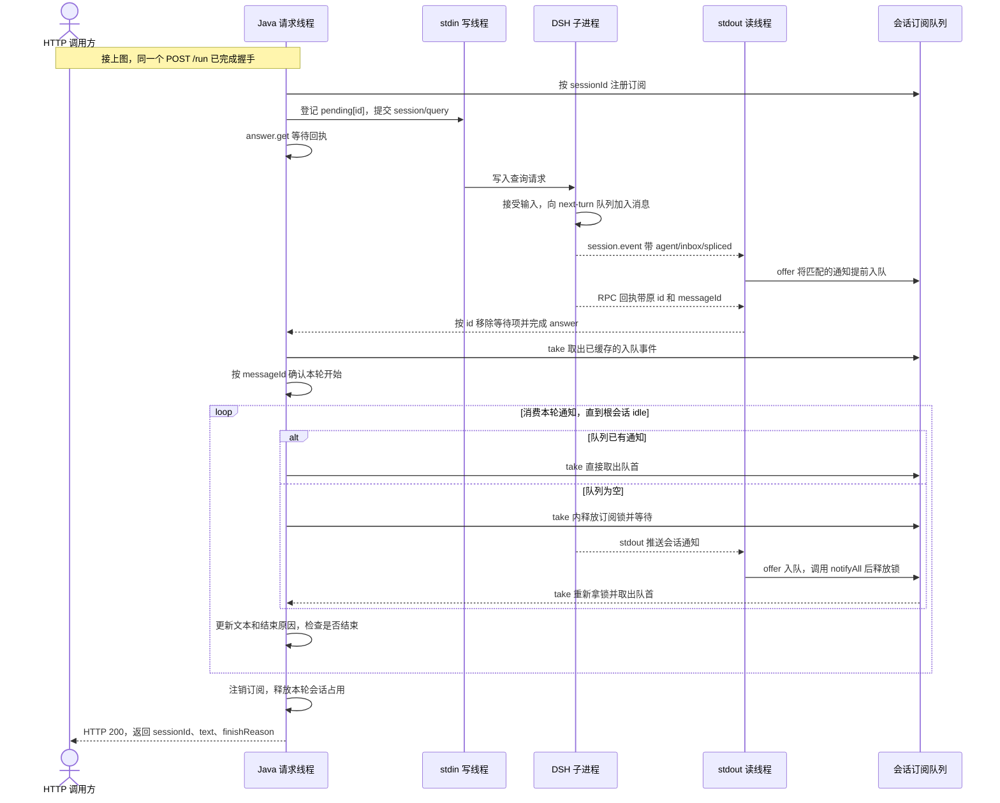

# Java DSH Bridge 架构实现方案

本文以应用启动后的第一个有效 `POST /run` 为例。请求提交一条普通提示词，省略 `sessionId`，并同步等待本轮最终结果。Spring Boot 启动时创建共享的 `DshSdk`，这次请求首次使用 SDK 时才启动 DSH 子进程。Java 通过 DSH 的 `stdin` 发送 JSON-RPC 消息，从 `stdout` 逐行读取回执和通知。

## 主流程

## 首次连接与握手

`/run` 通过应用服务和网关进入 `DshSdk.runStreaming()`。SDK 先生成 `sessionId`，再由 `openConnection()` 在 `lifecycle` 锁内创建共享的 `DshConnection`。它使用 `ProcessBuilder` 启动 DSH，启动读取线程和握手虚拟线程，并准备一个单线程写入器。HTTP 请求线程退出 `lifecycle` 锁后，通过 `initialized.get()` 等待握手结果。并发到达的其他有效请求可以共用这个连接和同一次握手。

`dsh-sdk-write-<pid>` 是单线程执行器的工作线程，多条出站消息由它逐条写入。`dsh-sdk-read-<pid>` 是守护线程，负责解析 `stdout` 上的 JSON 帧并调用 `dispatch()`。另一个守护线程独立读取 `stderr`，保留诊断输出。业务结果由请求线程消费和汇总。

## 提交会话请求与同步返回

1. **先订阅，再发查询。** 握手完成后，SDK 创建本轮截止时间，用 `sessionId` 登记 `EventSubscription`。发 `session/query` 时，又以 JSON-RPC 请求 `id` 在 `pending` 里登记 `answer`。写线程将请求写入 `stdin`，HTTP 请求线程调用 `answer.get(...)` 等待提交回执。
2. **接住提前到达的通知。** DSH 创建或取得会话，把输入追加到 Agent 的 `next-turn` 队列，并通过 `session.event` 发出 `agent/inbox/spliced`。这条通知在当前普通提示词路径上先于查询回执写出。读线程将它交给对应订阅入队，HTTP 请求线程仍可以继续等待 RPC 回执。
3. **按 RPC ID 唤醒请求线程。** DSH 返回包含 `kind=prompt` 和 `messageId` 的回执。读线程用回执的 RPC `id` 从 `pending` 取出并移除对应的 `answer`，调用 `answer.complete(frame)`。HTTP 请求线程从 `get()` 返回后进入 `collect()`，用回执的 `messageId` 匹配已入队的 `agent/inbox/spliced`，确认本轮开始。
4. **按会话消费后续通知。** 队列已有通知时，`take()` 直接取出队首。队列为空时，HTTP 请求线程通过 `timedWait()` 释放订阅对象的锁并等待。读线程收到匹配 `sessionId` 的通知后，调用 `offer()` 先入队，再 `notifyAll()`。读线程退出 `offer()` 后，HTTP 请求线程重新拿到锁，从队首取出通知。
5. **收到结束信号后同步返回。** `collect()` 从根会话的 `assistant/message` 更新文本，从 `turn/end` 提取结束原因。收到根会话的 `session.status=idle` 后，SDK 返回本轮结果，并在 `finally` 中注销会话订阅、释放本轮占用。网关将结果转换为 `DshRunResponse`，HTTP 响应包含 `sessionId`、`text` 和 `finishReason`。普通提示词的 `text` 取本轮最后一条根会话助手消息的文本。

## 三处等待和唤醒

| 等待什么 | 在哪里等待 | 怎样继续 |
| --- | --- | --- |
| 共享连接握手成功 | `initialized.get()` | 初始化线程校验响应后调用 `initialized.complete(null)`，等待该连接的请求可以继续。 |
| 当前 RPC 的提交回执 | `answer.get(...)` | `dispatch()` 按 RPC `id` 找到该请求的 Future，并调用 `answer.complete(frame)`。 |
| 当前会话的下一条通知 | `subscription.take(deadline)` | `offer()` 在订阅锁内入队并调用 `notifyAll()`。等待线程重新取得锁后，从队列取出通知。 |

握手使用 `initialize-timeout`。握手完成后，`session/query` 和后续事件等待共用本轮 `run-timeout`，每次等待都使用剩余时间。单次 RPC 等待结束后会清理 `pending`。连接失效时，SDK 会通知尚在等待握手、RPC 回执或会话通知的调用方，后续请求可重新启动 DSH。

HTTP 服务的执行等待默认最长 5 分钟，SSE 每 15 秒发送注释心跳。心跳和业务事件共用发射器发送锁，终态之后停止发心跳。检测到客户端断开后，Bridge 中断本轮 Java 等待，释放订阅和会话占用，已发给 DSH 的活动可能继续。

## 相关实现

- 同步 HTTP 请求入口与响应。[DshRunController.java](../java-dsh-bridge-adapter/src/main/java/cn/zntime/dsh/bridge/adapter/web/DshRunController.java)
- 会话执行、订阅生命周期与结果汇总。[DshSdk.java](../java-dsh-bridge-sdk/src/main/java/cn/zntime/dsh/bridge/sdk/DshSdk.java)
- 子进程启动、握手、串行写入与消息分发。[DshConnection.java](../java-dsh-bridge-sdk/src/main/java/cn/zntime/dsh/bridge/sdk/DshConnection.java)
- 通知过滤、队列与等待唤醒。[EventSubscription.java](../java-dsh-bridge-sdk/src/main/java/cn/zntime/dsh/bridge/sdk/EventSubscription.java)
- 帧类型、会话过滤与宿主反向 RPC 的详细说明。[DSH 连接的消息分发](dsh-connection-message-dispatch.md)
