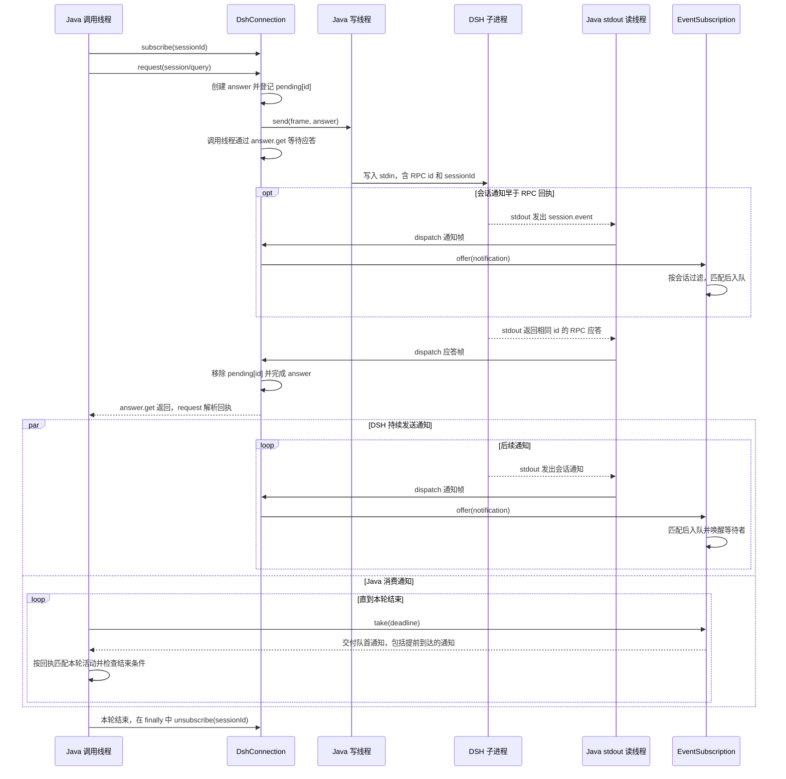
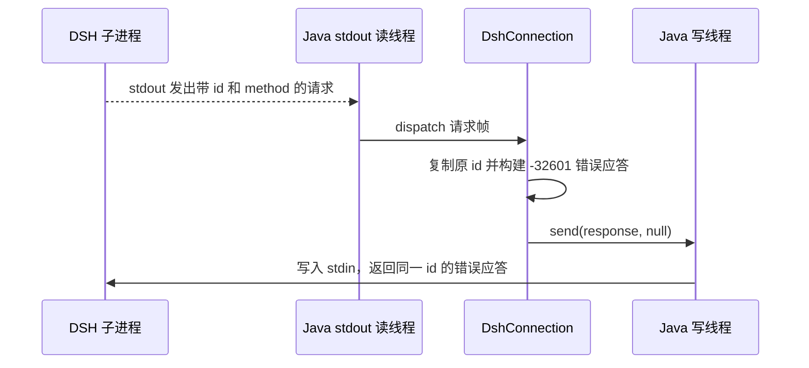

# DSH 连接的消息分发

Java Bridge 与 `dsh --profile sdk` 子进程通过标准输入和标准输出交换 JSON-RPC 2.0 消息，每行一帧。Java 的单线程写入器把消息写入 DSH 的 `stdin`，读线程从 DSH 的 `stdout` 逐行解析并调用 `DshConnection.dispatch()`。DSH 的 `stderr` 由独立线程读取，用于保留诊断信息。

## 帧类型与匹配方式

`dispatch()` 先检查帧是否为空，以及 `jsonrpc` 是否等于 `"2.0"`。通过检查后，按以下顺序处理。

| 帧的特征 | 含义 | 分发行为 |
| --- | --- | --- |
| `id` 是字符串或整数，`method` 是字符串 | DSH 调用 Java 宿主 | 使用原始 `id` 返回 `-32601`，错误消息为 `Host method not configured`。 |
| `id` 是字符串或整数，`method` 未解析为字符串 | DSH 对 Java 的 RPC 请求作出应答 | 将 `id` 转为字符串，从 `pending` 取出并移除对应的 `answer`。找到时执行 `answer.complete(frame)`。 |
| `id` 未通过字符串或整数判断，`method` 是字符串，`params` 是对象 | DSH 推送异步通知 | 获取当前订阅的快照，将通知逐个交给订阅检查。 |

`pending` 按 **JSON-RPC 请求 `id`** 匹配应答。`subscriptions` 按 **根会话 `sessionId`** 登记订阅，各订阅再按根会话和子会话过滤事件。同一会话可以发出多条 RPC，每条 RPC 各有自己的请求 ID 和 `CompletableFuture<JsonNode>`。

## RPC 应答与会话通知时序

以下以 `session/query` 为例。`DshSdk` 先登记会话订阅，`DshConnection.request()` 再登记 `pending[id]` 并提交写入任务。这个顺序允许读线程在 RPC 回执到达前接住会话通知。业务线程拿到回执后，从该订阅队列按序读取事件。

RPC 应答的 `answer.complete(frame)` 交付整条响应。业务线程从 `get()` 返回后，由 `request()` 读取 `result` 或把 `error` 转为 SDK 异常。`initialize` RPC 也使用同一路径，初始化线程校验应答后才完成连接级的 `initialized` Future。

会话通知使用独立队列。`dispatch()` 在 `synchronized (state)` 中用 `List.copyOf(subscriptions.values())` 取得快照，释放锁后才逐个调用 `offer()`。每个订阅维护已登记的会话 ID。收到属于当前会话树的 `subagent.started` 时会登记子会话 ID，后续子会话的事件便能进入同一队列。匹配的通知入队后，`offer()` 调用 `notifyAll()` 唤醒等待 `take()` 的线程。队列达到 8192 条时，这个订阅以 `SLOW_CONSUMER` 失败。

## DSH 调用宿主的时序

同一条连接也能收到 DSH 发给 Java 的 RPC 请求。当前 Bridge 对这类请求返回标准的 `-32601`。`send(response, null)` 把错误应答交给同一个写入器，`null` 表示这条出站帧没有关联的等待项。该分支发送后立即返回，避免使用宿主请求的 `id` 去匹配 Java 自己的 `pending`。

## 超时与断连

- **单次 RPC 超时或中断。** `request()` 在 `finally` 调用 `answer.cancel(false)` 并移除 `pending[id]`。写入任务如果尚未检查 `answer.isDone()`，就会跳过已取消的请求。已经发给 DSH 的 RPC 仍可能执行，迟到的应答找不到等待项时会被忽略。
- **检测到 SSE 断连。** 服务尝试定期写入 `:heartbeat` 注释，通过写入失败或 Servlet 容器回调中断等待任务。SDK 执行 `finally` 清理订阅并释放 Java 侧会话占用。
- **连接失效。** `stdout` 关闭或管道读写失败时，`fail()` 记录首个故障，异常完成尚未结束的握手和 RPC 等待项，并通知所有订阅。后续请求发现连接失效时会重建 DSH 连接。

## 源码入口

- `DshConnection` 管理子进程、握手、写入队列和消息分发。[DshConnection.java](../java-dsh-bridge-sdk/src/main/java/cn/zntime/dsh/bridge/sdk/DshConnection.java)
- `DshSdk` 在发送查询前登记订阅，并根据回执消费会话事件。[DshSdk.java](../java-dsh-bridge-sdk/src/main/java/cn/zntime/dsh/bridge/sdk/DshSdk.java)
- `EventSubscription` 过滤会话树中的通知，并负责排队和唤醒等待者。[EventSubscription.java](../java-dsh-bridge-sdk/src/main/java/cn/zntime/dsh/bridge/sdk/EventSubscription.java)
- HTTP 和 SSE 的完整链路见项目 README 中的时序图。[系统请求时序](../README.md#系统请求时序)
